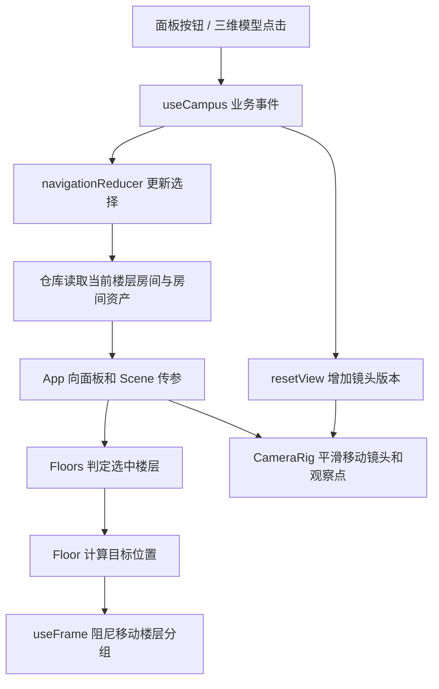

# 下钻与楼层展开技术分析

本文基于当前 `src/` 实现，说明从城市到房间的下钻、楼层抽离、内容切换和镜头动画。文中路径均相对于仓库根目录；代码片段仅摘录关键逻辑。

## 1. 实现的核心

系统通过一份选择状态同时驱动二维面板、三维模型、数据查询和镜头。楼层展开由模型分组位移实现；建筑外壳与室内内容则通过条件渲染切换。

目前是“选中楼层抽到中央，其余楼层侧移并淡化”的展示方式。它没有把导入的完整建筑网格切割成楼层，也没有给每个房间逐个播放拆解动画。



## 2. 文件职责

| 文件                                    | 职责                                       |
| --------------------------------------- | ------------------------------------------ |
| `domain/campus/constants.js`            | 五级名称与默认选择                         |
| `domain/campus/navigation.js`           | 下钻、返回、告警定位和资产选择的纯状态规则 |
| `app/hooks/useCampus.js`                | 参数校验、派发事件、查询数据、触发镜头复位 |
| `app/hooks/useSceneOptions.js`          | 图层、标签、环绕及镜头版本号               |
| `app/App.jsx`                           | 将选择状态、数据和回调分发给 UI 与三维场景 |
| `ui/components/SpatialPanel.jsx`        | 楼栋、楼层、房间及资产的索引入口           |
| `features/scene/Scene.jsx`              | 根据层级选择城市、园区或楼层场景           |
| `features/scene/models/Floors.jsx`      | 创建全部楼层，传递选中及展开状态           |
| `features/scene/models/Floor.jsx`       | 楼层位移动画、点击命中、幕墙及室内渲染     |
| `features/scene/config/layout.js`       | 楼层目标位置计算                           |
| `features/scene/controls/CameraRig.jsx` | 镜头和 OrbitControls 的过渡                |
| `features/scene/config/camera.js`       | 各层级镜头预设                             |
| `infrastructure/data/roomLayouts.js`    | 按楼栋及楼层分配模拟房间位置               |

## 3. 五级下钻状态

`level` 是业务层级，`floor` 是实际楼层号，两者不能混用。

| level | 页面范围 | 三维内容                                 |
| ----- | -------- | ---------------------------------------- |
| 0     | 城市     | 上海区界、地标及园区入口                 |
| 1     | 园区     | 道路、车辆、三座外观建筑                 |
| 2     | 楼宇     | 当前楼栋的楼层堆叠与屋顶                 |
| 3     | 楼层     | 选中楼层的六个房间与其他楼层淡化轮廓     |
| 4     | 房间     | 保留楼层内容，聚焦选中房间并显示设备标号 |

默认状态如下：

```js
const defaultSelection = {
  level: 1,
  buildingId: 'b-a',
  floor: 6,
  roomIndex: 1,
  asset: null,
};
```

关键状态转换：

| 事件             | 状态变化                                                     |
| ---------------- | ------------------------------------------------------------ |
| `selectBuilding` | 切换楼栋，设置有效默认楼层，进入 level 2，重置房间索引与资产 |
| `selectFloor`    | 更新 floor，进入 level 3，重置房间索引与资产                 |
| `selectRoom`     | 更新 roomIndex，进入 level 4，清空资产                       |
| `selectAsset`    | 保持空间层级，仅更新资产弹窗对象                             |
| `navigate`       | 修改 level，保留空间选择，关闭资产弹窗                       |
| `locateAlert`    | 同时设置楼栋、楼层、房间，直接进入 level 4                   |
| `reset`          | 恢复默认选择                                                 |

面包屑和步骤条调用 `go(level)`；它们允许跳转到现有选择对应的层级，不要求用户严格依次点击。

## 4. 点击某层后如何更新数据

以 A 座选择 8F 为例：

1. 面板执行 `selectFloor(8)`；三维楼层也通过 `onFloor(index)` 调用同一个业务函数。
2. `useCampus` 检查楼层为整数且处于 `1…building.floors`。
3. `transition` 派发 `{ type: 'selectFloor', floor: 8 }`，同时调用 `scene.resetView()`。
4. reducer 将 `floor` 更新为 8、`level` 更新为 3，并清除旧资产。
5. `useMemo` 因楼层依赖变化调用 `repository.getRooms(buildingId, 8)`。
6. 当前房间变为新房间数组的默认索引，资产再由 `repository.getAssets(room)` 派生。
7. `Floors` 让 `index === 8` 的分组成为选中楼层；对应室内模型和面板数据一起更新。

```js
const rooms = useMemo(
  () => repository.getRooms(selection.buildingId, selection.floor),
  [repository, selection.buildingId, selection.floor],
);
const room = rooms[selection.roomIndex];
const assets = useMemo(() => repository.getAssets(room), [repository, room]);
```

房间编号为 `801`、`802` 等，ID 为 `b-a-f8-r1`、`b-a-f8-r2` 等。设备 ID 带有所属房间 ID，因此切换楼层不会继续使用上一层的设备编号。

当前仓库为同步模拟仓库。接真实 API 时，应在应用层增加加载状态和请求竞态保护，防止用户快速从 8F 切到 9F 后，较晚返回的 8F 请求覆盖 9F。

## 5. 楼层展开的空间算法

`Floors.jsx` 按楼栋总层数生成稳定的楼层组件：

```jsx
<Floor
  key={`${building.id}-${i}`}
  index={i + 1}
  selected={floor === i + 1}
  expanded={level >= 3}
/>
```

同一楼栋切换楼层时 key 不变，已有分组继续从当前位置运动；切换楼栋时 key 变化，创建新楼栋的楼层分组。

`getFloorPosition` 根据状态返回目标位置。层高统一取自 `architecture.js` 的 `FLOOR_HEIGHT = 0.8`：

```js
export function getFloorElevation(floor) {
  return floor * FLOOR_HEIGHT;
}

export function getFloorPosition(index, expanded, selected) {
  return {
    x: expanded && !selected ? -17 : 0,
    y: getFloorElevation(index),
  };
}
```

| 状态         | x   | y           | 目的                       |
| ------------ | --- | ----------- | -------------------------- |
| 未展开       | 0   | index × 0.8 | 形成建筑层叠结构           |
| 展开且选中   | 0   | index × 0.8 | 当前层保留原标高展示       |
| 展开且未选中 | -17 | index × 0.8 | 其余层横向移开，保留原标高 |

例如 12 层楼中选择 8F：8F 保持 `(0, 6.4, 0)`；6F 移向 `(-17, 4.8, 0)`；9F 移向 `(-17, 7.2, 0)`。

**楼层展开不再降到固定高度 2。** 选中层保持对应楼层号的建筑标高，镜头随标高调整。切换到另一层时，旧楼层横向移开，新楼层在自身高度居中展示。

当前为横向抽离效果，不增加楼层之间的竖向间隙；如果要同时上下炸开，需要另行定义以 selectedFloor 为中心的位移策略。

## 6. 动画如何逐帧执行

`Floor.jsx` 使用 `useRef` 保存 Three.js Group，使用 R3F 的 `useFrame` 在每个渲染帧更新位置：

```js
useFrame((_, dt) => {
  ref.current.position.y = MathUtils.damp(ref.current.position.y, target, 5, dt);
  ref.current.position.x = MathUtils.damp(ref.current.position.x, targetX, 5, dt);
});
```

`dt` 为相邻帧的秒数。阻尼近似为：

```text
下一帧位置 = 当前位置 + (目标位置 - 当前位置) × (1 - exp(-5 × dt))
```

使用时间步长能减少不同帧率造成的速度差异。系数 5 越大，靠近目标越快；大约 0.6 秒可完成 95% 的位移，但实际还受渲染与帧间隔影响。

动画直接修改三维对象，不在每帧调用 React setState，避免整套面板和场景随每个动画帧重新渲染。目标改变时，会从分组的当前坐标继续向新目标过渡。

当前只有 x、y 位移为阻尼动画；透明度、幕墙移除、房间出现均为状态变化时立即切换，没有淡入淡出过程。分组挂载时初始位置为原点，因此第一次进入楼宇也会看到楼层移到堆叠位置。

## 7. 展开后渲染什么

`Floor.jsx` 有三部分内容：

- 楼板始终存在。展开时，非选中层透明度设为 0.065，并停止投射阴影。
- 未展开时显示四面幕墙、选中条和楼层按钮；屋顶只在 level 2 显示。
- `expanded && selected` 时显示室内房间和走廊线，并按 `r.floor === index` 过滤数据。

`Room` 是楼层分组的子节点，因此楼层运动时，房间、家具和房间标签跟随父分组移动。房间的局部位置来自数据中的 `position`，而不是独立维护一套世界坐标。

模拟布局通过楼栋偏移、楼层循环位移和方向变化，将六个房间分配到两排六个位置。相邻楼层有不同的功能区排列，但仍然使用相同尺寸的演示房间，并不代表真实建筑图纸。

房间层级仍保留整层其他房间，镜头只聚焦当前房间；没有单独卸载其余五个房间。

## 8. 镜头如何配合下钻

`transition` 同时更新业务状态与镜头 revision。后者使“层级不变但重新选择空间”或“重置当前视角”也能触发镜头过渡。

`getCameraPreset(level, roomPosition, floor)` 为 level 0～2 返回固定预设。level 3 的观察点为 `[0, elevation, 0]`，相机为 `[15, elevation + 14, 20]`；其中 `elevation = getFloorElevation(floor)`。房间镜头以房间平面坐标 `[x, z]` 和实际楼层标高为基准：

```js
return {
  position: [x + 7, elevation + 8, z + 10],
  target: [x, elevation, z],
};
```

`CameraRig` 在每帧同步插值相机与 OrbitControls 的 target：

```js
camera.position.lerp(p, 1 - Math.exp(-dt * 3));
controls.current.target.lerp(t, 1 - Math.exp(-dt * 3));
controls.current.update();
```

用户开始拖动时，`onStart` 关闭自动镜头过渡，避免程序与鼠标争抢相机。相机位置距离目标小于 0.03 时停止过渡；当前停止判断只检查相机位置，没有同时检查观察点误差。

楼层动画和镜头动画分别执行，阻尼系数分别为 5 和 3。代码没有统一时间轴，也没有等待“楼层移动完成”后才进入下一阶段。

## 9. 点击、遮挡和弹窗层级

楼层网格的点击由 R3F 射线命中触发。`stopPropagation()` 阻止事件继续传递到其他命中对象；HTML 楼层按钮也停止 DOM 事件冒泡。展开后的非选中楼层仍可重新选中。

房间点击后通过 `selectRoom` 进入 level 4。设备标号使用 Drei `Html`：它把三维位置投影到屏幕，再用 DOM 按钮实现点击。设备标号并非三维网格，不能只靠相机远近来保证弹窗遮挡。

当前通过三层约束解决标号盖住弹窗的问题：

1. `.scene` 使用 `isolation: isolate` 和 `z-index: 0`，建立独立层叠上下文。
2. 设备标号设定 `zIndexRange={[10, 1]}`，弹窗遮罩在外部使用 `z-index: 20`。
3. `App` 将 `assetOpen` 传给 Scene；资产弹窗开启时不渲染设备标号，关闭后恢复。

设备标号位于 Scene 内独立的 Html 节点，使用 `getFloorElevation(floor) + 1.7` 作为高度；它们没有挂到会移动的 Floor 分组中。因此在楼层移动过程中，标号与实体设备可能短暂不同步。若要精确跟随，可把设备标号移入对应 Room，使用设备局部坐标作为锚点。

## 10. 回归验证与修改入口

现有自动检查覆盖：楼宇、楼层、房间和设备 ID 关联；切换楼层后模拟布局变化；下钻返回和资产清理；告警定位；楼层目标坐标；房间镜头预设。

建议实际交互回归路线：A 座 2F → 返回楼宇 → 8F → 802 房间 → 打开设备 → 关闭弹窗 → 切换 B 座 1F。核对标题、房间编号、房间位置、设备 ID 与三维标号遮挡。

| 调整目标             | 修改入口                                                  |
| -------------------- | --------------------------------------------------------- |
| 改下钻及返回规则     | `domain/campus/navigation.js`                             |
| 改楼层偏移与展开高度 | `features/scene/config/layout.js`                         |
| 改楼层运动速度       | `Floor.jsx` 中 damp 系数                                  |
| 改镜头位置或运动速度 | `config/camera.js` 与 `CameraRig.jsx`                     |
| 更换真实房间平面     | 仓库房间数据及 `Room.jsx` 尺寸、门墙生成逻辑              |
| 做完整上下炸开动画   | 修改位置算法，显式传入 selectedFloor                      |
| 接入 GLB 分层建筑    | 将源模型按 floorId 分组，并复用现有选择状态和目标位移算法 |
| 让设备标号跟随实体   | 将 Html 锚点挂到 Room 或设备分组下                        |

以上分析描述当前实现与可改进点，不表示已经实现统一动画时间轴、真实楼层图纸或 GLB 自动分层。
